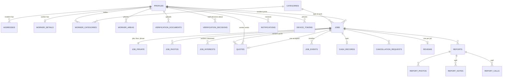

# DHA Works: Database Guide

For: Shariq Bhai. Written in plain English from the actual migration files in `supabase/migrations` (read on 30 Oct 2026). Where something could not be confirmed from the code, it says so.

## 1. Project overview

The database stores everything DHA Works needs: who the residents and workers are, whether DHA staff have verified them, the repair jobs residents post, the quotes workers send, how a job moves from "open" to "paid and rated", and the reports and audit trail staff use.

Three ideas run through the whole design:

- **The rules live in the database, not in the apps.** Every step a job takes (post, quote, accept, start, complete, cash, rate) is one database function. The function checks who is calling and what state the job is in, makes the change, and writes the history, all in one go. The apps cannot skip a step.
- **The apps can only read tables; they cannot write to them directly.** Writing happens only through those functions.
- **Private data is hidden by default.** A resident's phone and plot number reach only the worker whose quote they accept.

Size: 29 tables, 5 views, 33 functions the apps can call (listed in section 8), 4 private storage buckets.

## 2. Database status

| Environment | State |
|---|---|
| **Migration files in the repo** | 18 (0001 to 0017 and 0020) |
| **Local (Docker) database** | All 18 applied; `supabase test db` passed 592 assertions in 16 files on 30 Oct 2026. |
| **Hosted DEV** (Supabase free tier) | Migrations **0001 to 0015** are applied. **0016, 0017 and 0020 are not yet applied.** So hosted DEV is slightly behind the local schema. |
| **Production** | Does not exist. No production Supabase project has been created. |

The hosted-DEV status comes from the project notes and the 29 Oct check; re-check it with `supabase migration list --linked` before pushing. `docs/HANDOVER.md` and `README.md` now carry the same 18-migration status.

What 0016, 0017 and 0020 change, in short: a worker no longer needs to pick service areas before submitting for review (0016), the worker's job list shows how many quotes a job has (0017), and `public.notifications` is added to the Realtime publication (0020). None changes a table's columns.

## 3. How the pieces connect

Not drawn, to keep it readable: `app_settings`, `service_areas` (phases 1 to 8, referenced by addresses, jobs and worker areas), `job_views`, `worker_references`, `audit_log`, `staff_invites`.

## 4. Main tables

Money is stored in whole rupees. Every table has Row Level Security switched on (section 7).

### Accounts and verification

| Table | Purpose | Key columns and relationships |
|---|---|---|
| `profiles` | One row per sign-in account (resident, worker or admin). | `id` is the Supabase sign-in id. `role`, `full_name`, `phone`, `cnic`, `verification_status`, `account_status` (active or suspended). A worker signs in with `auth.users.phone` (WhatsApp OTP); `profiles.email` is nullable for phone-only accounts. A CNIC may appear once per role, so one person can hold one resident and one worker account. |
| `addresses` | A resident's saved addresses. | Belongs to a resident. `phase` (1 to 8), `lane`, `plot_no`, `floor`. One default address each. |
| `worker_details` | Worker-only profile data. | `experience_years`, `visit_fee`, `available_today`, voice intro file path. `rating_avg`, `rating_count`, `jobs_done` are kept up to date by the database functions, never typed in by the app. |
| `worker_categories` | Which trades a worker does (several allowed). | Worker + category. |
| `worker_areas` | Which DHA phases a worker serves. | Worker + phase. |
| `worker_references` | Two references from DHA residents, as an alternative to a police certificate. | Name, phone, address. |
| `verification_documents` | The current file for each document (CNIC front/back, utility bill, police certificate, profile photo). | One row per profile and document type; re-uploading replaces it. Stores a file path, not the file. |
| `verification_decisions` | History of every staff decision. | Decision (approve, ask for changes, visit HQ, reject), reason, ticked checklist, which staff member, when. |

Verification status values: `incomplete`, `pending`, `approved`, `needs_changes`, `visit_hq`, `rejected`.

### Jobs and quotes

| Table | Purpose | Key columns and relationships |
|---|---|---|
| `categories` | The 8 service categories (Plumbing, Electrical, AC & Refrigeration, Carpentry, Painting, Cleaning, Welding & Ironwork, General Handyman). | Staff-editable. |
| `service_areas` | DHA phases 1 to 8. | Staff-editable. |
| `jobs` | The repair request and its whole lifecycle. | Code like `DW-2001`. `resident_id`, `category_id`, `phase`, `lane`, `title`, `description`, `urgency`, `status`, `accepted_quote_id`, `accepted_worker_id`, scheduled/started/completed times, stuck and under-review flags, `material_bill_path` (added in 0013). |
| `job_private` | Plot number, floor and resident phone for a job. | Kept apart from `jobs` so it can be locked down separately. |
| `job_photos` | Up to 6 photos per job (file paths). | Belongs to a job. |
| `job_views` | Which workers have opened a job. | Used only for the "viewed" count. |
| `job_interests` | A worker saying "I'm interested". | Job + worker; can be withdrawn. |
| `quotes` | A worker's price offer. | `labour`, `materials`, `other_amount` and **`total` (calculated by the database, not the app)**, visit time window, status (`sent`, `accepted`, `rejected`, `not_selected`, `withdrawn`, `expired`). A worker can have one live quote per job; only one quote per job can be accepted. |
| `job_events` | Timeline of everything that happened to a job. | Append-only in practice (only database functions add rows). Some events are marked resident-only. |
| `cash_records` | The cash exchange for a job. | `agreed_amount` (the accepted quote total), the worker's amount and reason, the resident's amount, `matched`, `quote_difference`. Each side's amount can be entered once and never changed (a database trigger enforces this). |
| `cancellation_requests` | A request to cancel after a quote was accepted. | Requester, reason, status. Only one pending request per job. Staff decide. |

Job statuses: `draft`, `open`, `interested`, `quoted`, `accepted` (kept but **unused**), `scheduled`, `in_progress`, `completed`, `cash_collected`, `reviewed`, plus `disputed`, `cancelled`, `expired`.

### Reviews, reports and platform

| Table | Purpose | Key columns and relationships |
|---|---|---|
| `reviews` | The resident's rating of the worker. One per job. | Three scores 1 to 5 (behaviour, completeness, quality), hire-again yes/no, optional comment. |
| `reports` | A problem report. | Code like `RP-0401`. Job, reporter, person reported, kind (`unsafe`, `cash_price`, `no_show`, `poor_work`, `rude_damage`, `other`), status, staff outcome (`no_action`, `warning`, `suspend`), `system_generated` flag. |
| `report_photos`, `report_notes`, `report_calls` | Evidence photos; staff notes; staff call log for unsafe reports. | Belong to a report. |
| `notifications` | In-app and push messages. | Recipient, type, job, read time, push-sent time. |
| `device_tokens` | Phone push addresses. | Per user and device. |
| `audit_log` | Permanent record of who did what. | Append-only: the database refuses any update, delete or truncate, even for the service role. |
| `app_settings` | Tunable numbers and switches. | Key and value, e.g. job expiry 24 hours, report window 7 days, helpline (empty and off until DHA confirms). |
| `staff_invites` | Invitations for staff accounts. | Table exists, but nothing uses it yet (admin phase). |

## 5. How the main workflow works

1. **Registration.** A worker signs in with a phone number and WhatsApp OTP (handled by Supabase Auth); resident/admin sign-in is email/Google and is not built. Then `register_profile` creates the `profiles` row as a resident or worker. Workers also get a `worker_details` row. Email-only worker accounts need a one-time phone link before they can use the phone login.
2. **Verification.** They enter details, upload documents through the app, and call `submit_for_review`. The database checks the required items: both CNIC sides for everyone; a utility bill and an address for residents; a profile photo, at least one trade, and either a police certificate or two references for workers. Status becomes `pending`. Staff are notified. Workers pick their service phases **after** approval (0016).
3. **Staff decision.** The decision is recorded in `verification_decisions` and the status becomes `approved`, `needs_changes`, `visit_hq` or `rejected`. **The functions staff will use to make this decision are not written yet** (see section 10); the tables and statuses are ready.
4. **Posting a job.** The resident saves a draft (`save_job_draft`) and posts it (`post_job`): needs at least one photo, a description of 10+ characters and a date if scheduled. The job becomes `open`, the 24-hour clock starts, and every approved worker matching the category and phase is notified.
5. **Interest and quotes.** A matching worker marks interest (`express_interest`), then sends a quote (`submit_quote`). The job moves to `interested`, then `quoted`. A sent quote cannot be edited; the worker can withdraw it and send a new one. A worker the resident rejected cannot quote that job again.
6. **Acceptance.** `accept_quote` does everything at once: accepts the chosen quote, marks the others `not_selected`, moves the job to `scheduled`, creates the `cash_records` row, and releases the phone and plot to that one worker. It can only happen once per job. Before acceptance a resident can also `reject_quote` or `cancel_job`.
7. **The work.** The worker calls `start_job` (`in_progress`), then `complete_job` (`completed`). If the accepted quote included materials, the worker must attach a material bill (0013).
8. **Cash.** Both sides enter the amount (`record_cash_worker`, `confirm_cash_resident`); each amount is write-once. When both are in, the job becomes `cash_collected` and the worker's `jobs_done` goes up. **A price difference no longer creates a dispute** (0013): it is kept on `cash_records` (`matched = false`, `quote_difference`) for staff. A worker who charges a different amount from the quote must give a reason.
9. **Review.** Within 7 days of completion the resident calls `submit_review`. The job becomes `reviewed` and the worker's average is recalculated. A rating whose average of the three scores is **below 3** automatically files a `poor_work` report for staff (0013).
10. **Reports.** Either side can `file_report` from `scheduled` until 7 days after completion. Safety and price reports also flag the job for staff without changing its status.
11. **Cancelling after acceptance.** `request_cancellation` (while scheduled or in progress) creates a request for staff to decide; neither side can cancel alone.
12. **Automatic housekeeping.** A scheduled task runs hourly (`dw-hourly-sweeps`): it expires open jobs after 24 hours (a reminder goes out at 20), flags stuck jobs without changing their status, and sends one rating reminder 24 hours after completion.

## 6. Relationships: who owns what

- **A resident** owns their `addresses` and the `jobs` they post (`jobs.resident_id`). Each job has its `job_private`, photos, events, and at most one `cash_records` row, `reviews` row and accepted quote.
- **A worker** owns their `worker_details`, trades, phases and references. They connect to a job in three ways: `job_interests`, `quotes`, and (if chosen) `jobs.accepted_worker_id`.
- **A job** is the hub. Quotes, interests, photos, events, cash, cancellation requests, the review and reports all hang off one job id.
- **Staff (admin profiles)** appear as the decider on `verification_decisions`, the assignee on reports, and the author of report notes and call logs.
- Deleting an account row cascades to its dependent profile data (addresses, worker details, documents), but jobs, quotes and reports reference profiles **without** cascade, so they block deleting a profile that has activity.

## 7. Security and privacy

**Row Level Security (RLS)** means every row carries rules about who may see it, enforced inside the database itself. All 29 tables have it on, and a table with no matching rule returns nothing.

**Apps get read access only.** Signed-in users have `SELECT` on most tables, filtered by the rules below. They have **no** insert, update or delete rights on tables; every change goes through a function that checks the caller. The only exceptions are staff (admin) edits to `categories`, `service_areas` and `app_settings`. The anonymous (not signed in) role gets nothing. Migration 0015 also removed the unused TRUNCATE, TRIGGER, REFERENCES and MAINTAIN rights from the app roles.

| Data | Who can read it (from the policies) |
|---|---|
| Your own `profiles` row, addresses, worker data | You and staff. Other users never read these tables directly. |
| Other people's names and ratings | Only through views (section 8): a resident sees a quoting worker's name, rating and photo path; the worker's phone appears only on the **accepted** quote. |
| `job_private` (plot, floor, phone) | The job's resident, the **accepted** worker, and staff. No one else. |
| Open jobs | Approved, active workers whose trades and phases match, plus workers who already have interest or a quote on it. They see phase and lane only. |
| `quotes` | The resident who owns the job sees all quotes on it. A worker sees only their own, never competitors'. |
| `reviews` | The resident who wrote it and staff. **Workers cannot read reviews**; they see only their average and count. |
| `reports` and photos | The reporter and staff. The person reported cannot read them. Staff notes and call logs: staff only. |
| `cash_records`, cancellation requests | The job's resident, the accepted worker, and staff. |
| `notifications` | Only the recipient. |
| `device_tokens` | Nobody directly; only the registration function touches it. |
| `audit_log`, `staff_invites` | Staff only. Audit log cannot be edited or deleted by anyone. |
| Verification documents (table) | Staff always. The owner sees their own rows only while status is `incomplete` or `needs_changes`. |

**Private files.** The four buckets (`identity`, `job-media`, `worker-media`, `report-media`) are all private, with a 5 MB limit and restricted file types. Files are reached only through temporary signed links, in a folder named after the owner's id.

- `identity` (CNIC, bills, certificates): the owner can upload while their application is editable but **cannot read back**; only staff can read.
- `job-media`: the owner uploads. Photos and voice notes are readable by anyone allowed to see that job; the material bill only by its uploader, the job's resident and staff.
- `worker-media`: the worker manages their own files; any signed-in user can read an **approved** worker's files there (this is how residents see worker photos and voice intros).
- `report-media`: the reporter and staff only.

**Functions.** Every function the apps call is "security definer" with a fixed empty search path, checks the caller's role, approval and suspension itself, and is executable by signed-in users only. The push-notification service has a narrow, column-level set of rights (0014).

**Cannot be confirmed from the code:** which bucket each document type is stored in. The database records only a file path (it must start with the user's id); the bucket is chosen by the app. Also, the "service role" key bypasses RLS by design, so it must stay on the server only.

## 8. Functions and views

**Views** (read-only, filtered to the signed-in user, show only the columns screens need):

| View | Used for |
|---|---|
| `categories_with_counts` | Category tiles with "pros nearby" for the resident's default phase. |
| `resident_jobs` | A resident's own jobs with interest, quote and view counts, lowest quote, expiry time. |
| `resident_quotes` | Quotes on a resident's jobs plus the worker's public profile. |
| `worker_feed` | Open jobs matching the worker, excluding ones already engaged; phase and lane only. Has `quote_count` from 0017 (local only). |
| `worker_jobs` | The worker's own jobs. Resident name, phone, plot and floor appear only on jobs the worker won. |

These views deliberately run with the database owner's rights so they can join data the caller cannot read directly. Each filters on the signed-in user itself. Supabase's security advisor flags this pattern; the migration notes the warning is expected.

**Functions the apps can call** (`public`):

| Area | Functions |
|---|---|
| Account | `register_profile`, `update_my_profile`, `upsert_address`, `add_verification_document`, `set_my_references`, `submit_for_review` |
| Worker setup | `set_my_areas`, `set_my_categories`, `set_available_today`, `update_worker_details` |
| Resident jobs | `save_job_draft`, `delete_draft`, `post_job`, `update_job`, `cancel_job`, `accept_quote`, `reject_quote`, `confirm_cash_resident`, `submit_review` |
| Worker jobs | `record_job_view`, `express_interest`, `withdraw_interest`, `submit_quote`, `withdraw_quote`, `start_job`, `complete_job`, `record_cash_worker`, `get_my_earnings` |
| Both | `file_report`, `request_cancellation`, `withdraw_cancellation_request`, `register_device_token`, `mark_notifications_read` |

**Helper functions.** Public access helpers used by the security rules: `current_user_role`, `is_admin`, `is_active_approved`, `is_approved_worker`, `worker_matches_job`, `worker_has_stake`, `is_job_owner`, `is_accepted_worker`, `can_view_job`, `get_setting`. A hidden `private` schema (not reachable from the apps) holds internal helpers: caller check, timeline and audit writer, notification creators, stage recalculation, cash settlement, and the three hourly sweeps.

**Triggers.** Keep `updated_at` current; make cash amounts write-once; make `audit_log` append-only.

## 9. Migrations

A **migration** is a numbered SQL file that changes the database structure. Files run in order, are never edited after the fact, and every environment is built from the same list, so local, DEV and production can be rebuilt identically.

| # | What it does |
|---|---|
| 0001 | Fixed lists of values (roles, job statuses, quote statuses, report kinds, etc.) and the `updated_at` helper. |
| 0002 | Categories, phases 1 to 8 and app settings, with starting values. |
| 0003 | Profiles, addresses, worker details, trades, areas, references, documents and verification decisions. |
| 0004 | Jobs, private job details, photos, interests, quotes, timeline, cash records, cancellation requests. |
| 0005 | Reviews, reports (and photos, notes, calls), notifications, device tokens, audit log, staff invites. |
| 0006 | Row Level Security rules, access helper functions and read-only grants. |
| 0007 | Private helper schema; account, verification, notification and report functions. |
| 0008 | Resident job functions (draft, post, edit, cancel, accept, reject, cash, review). |
| 0009 | Worker functions (setup, interest, quotes, start, complete, cash) and cancellation requests. |
| 0010 | The five read views and `get_my_earnings`. |
| 0011 | Hourly scheduled sweeps (expiry, stuck jobs, rating reminders). |
| 0012 | Four private storage buckets and their access rules. |
| 0013 | Shariq's 28 Oct feedback: material bill required when the quote has materials; a price difference no longer disputes a job; a rating below 3 files a `poor_work` report. |
| 0014 | Minimum column-level rights for the push-notification service. Function not deployed yet. |
| 0015 | Removed unneeded table rights (TRUNCATE, TRIGGER, REFERENCES, MAINTAIN) from app roles, now and for future tables. |
| 0016 | `submit_for_review` no longer requires service areas; workers choose phases after approval. **Local only.** |
| 0017 | Adds `quote_count` to `worker_feed`. **Local only.** |

Two further files, `supabase/proposals/20261029000018` and `...019` (lock identity details during review; let owners delete their own identity files), are **proposals, not migrations**, and are not applied anywhere.

## 10. Limitations and pending items

**Not yet applied to hosted DEV:** migrations 0016 and 0017. Production does not exist.

**Not built yet (no tables or functions for them):**
- **Staff actions.** There are no functions yet for approving or rejecting workers and residents, deciding cancellation requests, resolving reports, suspending accounts, or inviting staff. Policies let staff *read*, but the admin portal's write functions belong to the admin phase. Until then, the `verification_decisions` and `reports` workflows cannot be completed from the apps.
- **Push notifications.** The send function is built and tested locally but not deployed (no secret, no scheduler).
- Phone OTP for the customer app, chat, direct booking, commission, refunds and quote revisions are out of MVP 1 by decision. The worker app uses phone + WhatsApp OTP.

**Awaiting Shariq (from `docs/OPEN-QUESTIONS.md`; the database currently follows the assumption in bold):**
- Cash may become worker-only: **both sides still enter the amount.** If yes, a new migration will change it.
- Material bill: **required only when the quote has materials.**
- "Rated below 3": **built as the average of the three scores below 3.**
- Price difference: **job closes as `cash_collected`**, both amounts kept for staff.
- "v2 need expiry": not understood; nothing built.
- Helpline number and switch: **empty and off.**
- Retention period for identity documents: **none set**, pending legal review.

**Known gaps (documented, not fixed):**
- Workers whose application is pending, visit-HQ or rejected can still change trades, experience, fee and voice intro (`set_my_categories`, `update_worker_details` have no status check).
- Identity files cannot be replaced or deleted by the worker, so a re-upload leaves the old file in the private bucket.
- An approved worker with no phases sees no jobs until `set_my_areas` is called.
- The `accepted` job status exists in the list but is never used.
- Hosted DEV has no point-in-time backup (free tier); no real CNIC or resident data should be stored until a backup and restore is tested.

**Cannot be confirmed from the repository:** the live state of hosted DEV (taken from project notes), and whether local databases on other machines match.
